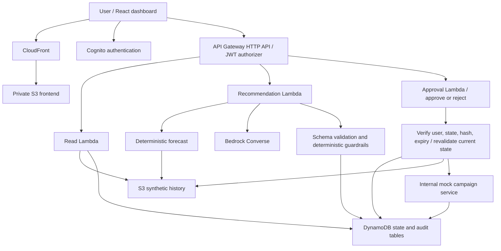
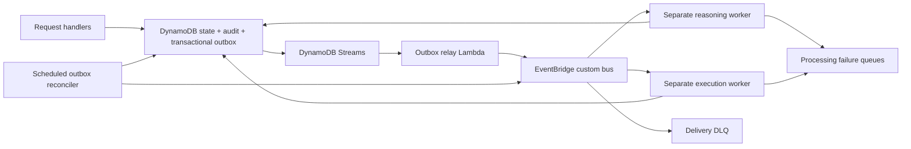

# JMB Advertising Demand & Campaign Optimizer

Status: Phase 1 local prototype implemented. The cloud architecture below remains a future design; no AWS resources, Terraform code, or Bedrock calls exist. V1 prioritizes simplicity, low AWS cost, and an easy live demonstration.

## Phase 1 implementation

React/TypeScript (Vite) calls a loopback-only FastAPI server on Python 3.12. Pure forecasting and guardrail functions feed a proposal-only FixtureReasoner. An explicit local demo identity represents the human; Cognito is deferred until cloud work is approved. State is one local JSON snapshot with a cross-process file lock and atomic replacement, so approval, mock mutation, idempotency receipt, and append-only audit commit together. Existing audit entries cannot be changed through the application. The operator can still edit local files; this is not a tamper-proof archive.

Fixture reasoning is fast and has no network calls, so the entire request runs within a short file transaction. There are no GENERATING reservations or interrupted-model recovery jobs in Phase 1. A failed local transaction makes no partial change; retrying the same key returns its saved result if the commit already succeeded. Future Bedrock orchestration must move network calls outside the file lock and implement the request deadline/reservation contract below. FixtureReasoner receives a deep copy of input data and has no repository or campaign-service handle.

Histories are generated with stable seeds and an explicit end date. First startup creates a fresh dataset ending yesterday UTC; restarting retains it and its audit history. To demonstrate on a later day, select a new LOCAL_STATE_PATH as documented in README, preserving the prior session. Smart TV demonstrates the weekly-cap failure; Bluetooth Speaker demonstrates insufficient inventory. See [README](README.md) for local commands and [local phase contract](docs/api-contract.md#phase-1-local-contract) for the smaller API behavior.

## Scope and safety boundary

A portfolio application demonstrates deterministic demand forecasting, AI campaign reasoning, policy validation, explicit human decisions, and auditable simulated execution. Every screen and campaign response labels campaign activity **SIMULATION — no real advertising spend**. AWS hosting and Bedrock may incur infrastructure charges when deployed; simulated budgets do not spend money.

Only a mock campaign adapter will exist. There are no advertising provider credentials, SDKs, endpoints, or production adapter configuration switches. AI output is untrusted proposal data. The Recommendation Lambda cannot invoke the Approval Lambda or modify campaign/approval records. Numerical forecasting never uses an LLM.

## Components

All Lambdas use Python 3.12 and structured CloudWatch logging. React uses TypeScript. Cognito is a supporting service to bind decisions to a verified identity; API keys or browser-supplied user IDs do not establish approval identity. Each user owns an isolated simulation with the same five initial products. A local development mode uses local fixtures, a deterministic reasoning stub, and local repositories without requiring AWS; AWS mode uses Bedrock and fails closed if it is unavailable.

## Workflow and consistency

1. Authenticated user selects a product. Read API returns its 90-day history, current simulation campaign, inventory, and a deterministic seven-day forecast.
2. The Recommendation Lambda reserves the idempotency key with a `GENERATING` record and request audit event in one transaction. It performs all remaining work in this same HTTP invocation; nothing is queued.
3. It reads versioned history and campaign/inventory snapshots, calculates the forecast, and calls Bedrock with product data, history, forecast, campaign metrics, and inventory. Persist the input snapshot reference/hash, algorithm and prompt versions, model ID, output, and token usage.
4. Strictly validate the model response. Unknown actions, malformed JSON, non-integer budgets, or invalid ranges fail closed. Save recommendation, every policy result, and audit records atomically. Status becomes `AWAITING_APPROVAL`, `BLOCKED`, or `FAILED`.
5. Return HTTP 201 with the ready recommendation and checks. UI displays the proposal, concise reasoning, forecast method and accuracy, all checks, and explicit Approve/Reject controls. Approval is enabled only for `AWAITING_APPROVAL`; no prechecked approval or automatic timeout approval.
6. The Approval Lambda handles the decision request. It verifies authenticated owner, immutable proposal version/hash, state, and expiry. Reject atomically stores the decision and audit, transitions an undecided proposal to `REJECTED`, and returns 200. A generation-blocked proposal may be rejected but cannot be approved.
7. For APPROVE, it re-runs all deterministic guardrails against current campaign/inventory, recomputes the deterministic forecast from the referenced history, and verifies dataset freshness and policy version. It builds a server-validated human decision context; browser flags and AI output cannot supply this context. Only then does it call the private mock service in the same invocation.
8. The mock service commits one DynamoDB transaction: immutable human approval, conditional campaign update, `EXECUTED` recommendation, unique action receipt, saved idempotent response, and approval/validation/action audit records. Audit is part of the commit, not a follow-up write. Return 200 with the executed action only after commit. A version change yields audited `STALE`; a failed execution guardrail yields audited `BLOCKED`; expiration yields audited `EXPIRED`. These outcomes record the human attempt but never change the campaign. No approved recommendation can execute twice.

State machine: `GENERATING -> AWAITING_APPROVAL | BLOCKED | FAILED`; `AWAITING_APPROVAL -> EXECUTED | REJECTED | STALE | EXPIRED | BLOCKED`; generation `BLOCKED -> REJECTED | EXPIRED`. A BLOCKED record with a committed decision is terminal. No persisted `APPROVED` waiting state exists in V1: successful approval and execution commit together. Terminal records cannot be approved again. Recommendation expiry is the earlier of creation + 30 minutes and the next UTC day boundary. Every decision checks the timestamp. Reads expose effective EXPIRED status for elapsed undecided proposals; the next decision request persists that transition and audit atomically. No scheduler or TTL is required for correctness.

## Request deadlines and retries

API Gateway HTTP APIs have a maximum 30-second integration timeout. V1 plans a 25-second Lambda timeout, a 20-second application work deadline, and a bounded Bedrock call within that budget, reserving time for persistence and the response. Select and measure a model that fits this budget; slow models may require the future asynchronous design. See [AWS HTTP API quotas](https://docs.aws.amazon.com/apigateway/latest/developerguide/http-api-quotas.html).

Both POST routes use durable idempotency keys scoped to owner, operation, and target resource, with a canonical body hash. Completed retries return the saved response. A concurrent recommendation retry returns 409 REQUEST_IN_PROGRESS with Retry-After; it does not call Bedrock again. An abandoned GENERATING request is finalized FAILED by the next same-key POST after its fixed request deadline; it is never taken over or regenerated automatically. Reads can report effective FAILED after that deadline without writing. A new recommendation requires an explicit new key. There is no background recovery promise. Transient approval failures before commit can retry the identical decision/key; a committed action with a lost response is returned from its saved receipt. A transport timeout is an unknown outcome, never proof that a campaign changed or did not change.

V1 has no DynamoDB Streams relay, EventBridge custom bus, scheduled reconciler, asynchronous reasoning/execution workers, or workflow SQS dead letter queues.

## Deterministic forecasting

Synthetic history has 90 consecutive UTC dates per product, integer nonnegative units, stable product-specific seed, weekday seasonality, mild trend, and bounded noise. No external product or campaign APIs are needed. The seed manifest specifies an explicit end date, random seed, and generator version; AWS initialization chooses yesterday UTC and records it. Historical fixtures remain reproducible. Regenerate a fresh version for demos rather than silently rewriting a snapshot.

Baseline: for each future weekday use the mean of its four most recent observations. Round half up to nonnegative integer units; sum the seven rounded predictions. No trend extrapolation in version 1. Missing dates, fewer than 90 observations, duplicates, or invalid values fail validation rather than inventing observations.

Backtest with four non-overlapping seven-day holdouts at the end of the 90-day series. For each holdout, train only on earlier observations and apply the same algorithm. `WAPE = sum(abs(actual - prediction)) / sum(actual)` across all 28 validation days. `confidenceScore = max(0, 1 - WAPE)`; an all-zero validation denominator makes confidence unavailable and blocks approval. This is a historical accuracy proxy, **not a probability or statistical confidence interval**. Compare the unrounded score against 0.80. UI labels it “Forecast confidence (backtest accuracy)” with this explanation.

Inventory requirement is `ceil(sum(forecast units) * 1.10)`, using available inventory (on-hand minus reserved units). The 10% buffer is a conservative demo policy, not an estimated causal ad uplift. Inventory is checked at generation and execution. Historical end date must be yesterday UTC at generation and execution; crossing the day boundary requires a new proposal with fresh history. The forecast horizon is the next seven dates after history end.

## Deterministic policy

USD amounts are integer cents. Proposed action is limited to `SET_WEEKLY_BUDGET`; unchanged and reduced budgets also require approval to keep all actions under one control path. Positive current budgets are required.

| Check | Passing rule |
|---|---|
| Budget increase | `proposedWeeklyBudgetCents * 100 <= currentWeeklyBudgetCents * 120` |
| Weekly cap | `0 <= proposedWeeklyBudgetCents <= 500000` per campaign/product, not account-wide |
| Forecast confidence | Available score >= 0.80 |
| Inventory | Available units >= buffered seven-day demand |
| AI execution isolation | Only allowlisted proposal schema; reasoning role cannot execute or mutate campaigns |
| Human approval | Pending before decision; execution requires authenticated APPROVE bound to proposal hash and persisted atomically with the action |
| Input integrity/freshness | Valid input, unchanged campaign/inventory versions, fresh history, unexpired proposal |

Each result includes ID, phase, PASS/FAIL/PENDING, observed value, limit, policy version, and readable explanation. `PENDING` human approval is expected for an otherwise eligible proposal; it is never treated as execution permission. Approval eligibility requires all other checks PASS. Execution requires every check PASS. The UI preserves both generation and execution validation records.

## Bedrock boundary

`ReasoningService.recommend(context) -> CampaignProposal` is a domain port with `BedrockConverseReasoner` and explicit local-only `FixtureReasoner` adapters. Read `BEDROCK_MODEL_ID` from the environment; accept a compatible model ID or inference profile ID. Use SDK default credential resolution and Lambda IAM roles, never embedded keys. Converse `messages` carry data and `system` carries proposal-only instructions. No execution tools are exposed. Request structured JSON and validate it locally regardless of model capabilities. Store concise decision rationale, not hidden chain-of-thought. Limit output tokens, retries, prompt size, and invocation concurrency. Missing model configuration or repeated invalid output creates audited `FAILED` status; no silent cloud fallback.

## Security and operations

JWT subject determines simulation ownership; every query, command, and cursor is scoped to it. Disable public sign-up by default; provision demo users deliberately. Private S3 buckets block public access and require TLS; CloudFront uses origin access control. Runtime roles have scoped permissions; only the Approval Lambda and setup seeding role can change campaign state. Audit writers may append but not update/delete records. Atomic writes fail if audit cannot persist. This is immutable history at the application boundary, not a regulatory tamper-proof archive against administrators.

Log correlation ID, recommendation ID, request ID, status, and duration; never log tokens or credentials. Track request errors, latency, throttling, and Bedrock failures in CloudWatch. Use low reserved concurrency, API throttles, bounded tokens, on-demand DynamoDB, and short log retention. Local demos use the explicit fixture reasoner without AWS calls. UI renders reasoning as escaped text. No VPC is needed for the initial managed-service architecture.

## Production Scale Evolution

The original event-driven/outbox architecture is a future option when recommendation generation and execution need asynchronous processing, higher throughput, independent scaling, replay, and stronger failure isolation. It is not part of V1 scaffolding or implementation milestones.

Requests would atomically store business state, audit, and outbox records, returning 202. Approval would persist an APPROVED state and matching human decision before queuing execution. The execution worker would independently verify the stored approval, proposal hash, freshness, and current guardrails before atomically applying a mock action. The relay would publish outbox entries to EventBridge, marking only successful PutEvents entries delivered. A scheduled reconciler would republish pending entries and re-drive stranded jobs. Worker claims/leases, bounded retries, idempotent consumers, separate delivery/processing dead letters, and replay tooling would handle duplicate and out-of-order delivery without duplicate actions. Durable receipts and transaction conditions remain necessary. See each supporting specification's evolution section for the additional contracts and resources.

## Supporting specifications

- [Repository structure](docs/repository-structure.md)
- [API contract](docs/api-contract.md)
- [DynamoDB data model](docs/dynamodb-data-model.md)
- [Terraform resource plan](docs/terraform-resource-plan.md)
- [Implementation plan](docs/implementation-plan.md)

AWS references checked for this design: [Converse API](https://docs.aws.amazon.com/bedrock/latest/APIReference/API_runtime_Converse.html), [DynamoDB transactions and idempotency](https://docs.aws.amazon.com/amazondynamodb/latest/developerguide/transaction-apis.html), [S3 origin access control](https://docs.aws.amazon.com/AmazonCloudFront/latest/DeveloperGuide/private-content-restricting-access-to-s3.html), [CloudFront certificate region](https://docs.aws.amazon.com/AmazonCloudFront/latest/DeveloperGuide/cnames-and-https-requirements.html).
