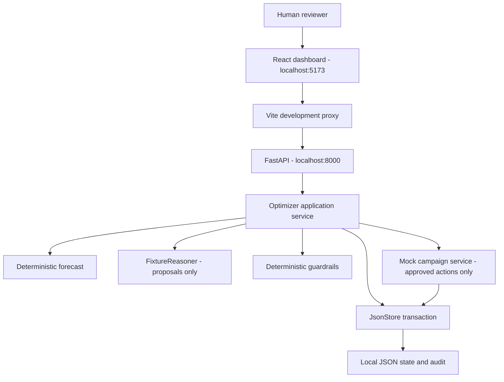

# JMB Advertising Demand & Campaign Optimizer

**End-to-end explanation of the Phase 1 local prototype**

**Status:** Working local application. AWS deployment and Amazon Bedrock integration are future work.

**SIMULATION — No real advertising spend.**

## 1. Purpose

This portfolio application demonstrates a controlled advertising decision workflow: use historical product demand to calculate a forecast, propose a campaign budget, validate the proposal against business rules, require a human decision, and record the outcome.

The business question is: **Should the advertising budget for this product change, given expected demand, available inventory, and budget limits?**

The application shows how to separate numerical prediction, recommendation generation, authorization, and execution. A recommendation is advisory. Passing business checks makes it eligible for review; only an explicit human approval followed by successful revalidation can change the simulated campaign.

Phase 1 prioritizes a working demonstration, low operating cost, understandable code, and repeatable tests. It runs on one computer and makes no AWS or external advertising API calls.

## 2. What is implemented

| Capability | Current implementation |
|---|---|
| Dashboard | React and TypeScript, served locally by Vite |
| Backend | Python 3.12 with FastAPI and Uvicorn |
| Product data | Five synthetic products, each with 90 daily observations |
| Forecasting | Deterministic weekday-average algorithm |
| Forecast evaluation | Four historical seven-day backtests |
| Recommendation | Deterministic FixtureReasoner |
| Policy enforcement | Python guardrail functions |
| Human decision | Explicit Approve or Reject request |
| Campaign execution | Private in-process mock campaign service |
| Persistence | Local JSON file with file locking and atomic replacement |
| Audit | Append-only records enforced by the application |
| Duplicate-request protection | Persisted idempotency keys and action receipts |
| Tests | Python unit/integration tests and a browser workflow test |

The UI uses the label “AI recommendation” to represent the intended reasoning capability, but the current engine is explicitly labeled **FixtureReasoner — deterministic demo — no LLM calls**. It uses fixed rules, not a trained model. This is a prototype of an AI-assisted workflow, not an autonomous advertising agent or a proven mathematical budget optimizer.

## 3. Current architecture



The browser renders the dashboard and sends HTTP requests. FastAPI validates request structure and routes requests to application services. The `Optimizer` coordinates forecasting, reasoning, policy evaluation, decisions, and persistence.

The reasoner has no repository or campaign-service handle. It receives a deep copy of context and returns proposal data. It cannot use that input to update stored campaigns. The mock service is a Python function inside the backend, not a separate server or publicly exposed campaign mutation endpoint.

Requests complete synchronously. There are no background workers, queues, event buses, or scheduled jobs in Phase 1.

## 4. How the code is organized

The implementation separates responsibilities so future infrastructure changes do not require rewriting the forecast or business rules.

| Location | Responsibility |
|---|---|
| `frontend/src/main.tsx` | Mounts the React application |
| `frontend/src/app/App.tsx` | Dashboard, product selection, request handling, decisions, audit display |
| `frontend/src/api/client.ts` | Typed API calls and display formatting |
| `frontend/src/components/DemandChart.tsx` | SVG history/forecast chart and accessible data table |
| `backend/src/optimizer/handlers/api.py` | FastAPI routes, local configuration, request validation, composition |
| `backend/src/optimizer/application/service.py` | Recommendation generation, state transitions, idempotency, audit, approval orchestration |
| `backend/src/optimizer/application/mock_campaign.py` | Applies a validated, approved simulated budget change |
| `backend/src/optimizer/domain/forecast.py` | Forecast and historical accuracy calculations |
| `backend/src/optimizer/domain/guardrails.py` | Policy rules and individual check results |
| `backend/src/optimizer/domain/schemas.py` | Strict proposal and decision schemas |
| `backend/src/optimizer/ports/reasoner.py` | Proposal-only reasoning interface |
| `backend/src/optimizer/adapters/local/reasoner.py` | FixtureReasoner implementation |
| `backend/src/optimizer/adapters/local/seed.py` | Deterministic product, history, inventory, and campaign generation |
| `backend/src/optimizer/adapters/local/store.py` | Locked JSON reads and atomic transactions |

The build included synthetic fixtures, pure forecast/policy functions, the reasoning interface, local persistence and application workflow, HTTP endpoints, the dashboard, and automated verification. AWS adapters and Terraform were deliberately left unimplemented.

## 5. Synthetic data and initialization

The five products and initial campaign budgets are:

| Product | Initial weekly budget | Available inventory | Demonstration purpose |
|---|---:|---:|---|
| Wireless Headphones | $1,000 | 1,500 units | Successful approval |
| Smart TV | $4,500 | 500 units | Weekly budget cap failure |
| Streaming Device | $600 | 900 units | Additional eligible proposal |
| Gaming Controller | $800 | 1,100 units | Additional eligible proposal |
| Bluetooth Speaker | $700 | 100 units | Inventory failure |

Each product receives 90 consecutive daily observations, for **450 observations in total**. The generator combines a product-specific base demand, weekday seasonality, a mild trend, seeded variation, and a deliberately quieter final week. This makes the weekday baseline predict a recovery and gives the demonstration a clear budget-review scenario.

The same seed and end date produce the same data. The data is illustrative; the resulting forecast accuracy is not evidence of real-world predictive performance.

On startup, if the selected state file does not exist, the backend saves a new dataset ending yesterday in UTC, initial campaign metrics, inventory, and initialization audit records. If the file already exists, the saved simulation is retained. Startup does not overwrite prior campaign decisions.

The committed files under `data/synthetic/` are reproducible reference fixtures. The running application initializes its state using the same generator; it does not read those exported files on every request.

## 6. The complete user journey

### Step 1: Open the dashboard and select a product

The browser retrieves the product catalog. Selecting a product loads its history, forecast, campaign, previous recommendations, and audit records.

The dashboard displays historical demand, seven predicted daily quantities, projected demand change, backtest accuracy, current budget, synthetic performance, and available inventory. The chart also has a table alternative for inspecting the underlying values.

### Step 2: Calculate the seven-day demand forecast

For each future date, the backend finds the four most recent observations for the same weekday and averages their demand.

For example, if the last four Mondays recorded 80, 84, 88, and 92 units:

```text
Predicted Monday demand = (80 + 84 + 88 + 92) / 4 = 86 units
```

The algorithm repeats this for all seven forecast dates, rounds each prediction half up to whole units, and sums the seven results. There is no LLM call, model training, or trend extrapolation in this calculation.

The history must contain exactly 90 consecutive, ascending dates with nonnegative integer demand. Missing dates, duplicates, invalid quantities, and other unusable inputs are rejected.

### Step 3: Evaluate historical forecast accuracy

The backend runs four non-overlapping historical backtests:

| Backtest | Training observations | Predicted observations |
|---|---|---|
| 1 | Days 1–62 | Days 63–69 |
| 2 | Days 1–69 | Days 70–76 |
| 3 | Days 1–76 | Days 77–83 |
| 4 | Days 1–83 | Days 84–90 |

Each backtest uses only observations available before its prediction period. Later actual values are not included in training that prediction.

Errors across all 28 held-out days are combined using weighted absolute percentage error:

```text
WAPE = sum(abs(actual units - predicted units)) / sum(actual units)
Forecast confidence score = max(0, 1 - WAPE)
```

For example, WAPE of 0.13 produces an 87% score. **This score describes historical backtest accuracy; it is not an 87% probability that future demand will occur.** If the denominator is zero, confidence is unavailable and the confidence guardrail fails.

### Step 4: Compare forecast demand with the previous week

The displayed demand change is:

```text
Demand change % = (predicted next-seven-day units / previous-seven-day units - 1) × 100
```

For the reference Headphones dataset ending September 19, 2026, the next-week forecast is 641 units versus 530 units in the previous week: approximately **+20.9%**, with approximately **92.6%** backtest accuracy.

The percentages are calculated from the history rather than hardcoded into the dashboard. A percentage is unavailable when the previous week's total is zero.

### Step 5: Generate a recommendation

The user clicks **Generate recommendation**. The browser submits a POST request with a UUID `Idempotency-Key`.

The backend snapshots the selected product, history, forecast, campaign metrics, budget, and inventory. It passes a deep copy to `FixtureReasoner.recommend(context)`.

The current rule is intentionally simple:

- Positive forecast demand change: propose a 15% budget increase.
- Zero, negative, or unavailable demand change: propose maintaining the budget.
- Inventory sufficiency changes the explanation; deterministic guardrails decide whether the proposal is eligible.

The fixture receives campaign performance in its context, but does not optimize using clicks, conversions, or return on ad spend. The 15% uplift is a demonstration rule, not an inferred causal relationship between advertising spend and sales.

Its output contains `SET_WEEKLY_BUDGET`, the proposed amount, a short rationale, and assumptions. For example:

```text
Current weekly budget: $1,000
Proposed weekly budget: $1,150
Reason: Forecast demand is increasing while sufficient inventory is available.
```

Strict schema validation rejects unsupported actions or malformed output. Trusted values such as current campaign budget and proposal identity come from the application, not from the reasoner.

### Step 6: Run deterministic guardrails

The backend evaluates each check and returns its status, observed value, limit, explanation, policy version, and phase.

| Guardrail | Rule |
|---|---|
| Budget increase | Proposed budget cannot exceed 120% of current budget |
| Weekly budget | Proposed budget must be between $0 and $5,000 per campaign |
| Forecast confidence | Backtest score must be at least 80% |
| Inventory | Available units must cover predicted weekly units plus 10% |
| Freshness | Inputs must be current; execution also checks snapshot and policy consistency |
| Reasoner isolation | Proposal-only component has no campaign mutation capability |
| Human approval | Pending until an explicit approval request is validated |

Money is stored as integer cents. For example, $1,000 is `100000`, and the increase check uses integer arithmetic:

```text
proposedBudgetCents × 100 <= currentBudgetCents × 120
```

Required inventory is `ceil(predicted weekly units × 1.10)`. For 641 forecast units, the requirement is 706 units. The buffer is a conservative demo rule, not an ad-uplift forecast.

The reasoner-isolation row reports a property of the component design; it does not dynamically inspect permissions or provide an operating-system sandbox.

If every non-human check passes, the recommendation becomes `AWAITING_APPROVAL`. If any fails, it becomes `BLOCKED`. Human approval being PENDING is expected before a decision and never permits execution by itself.

The backend saves the proposal, input snapshot, validation results, audit events, and idempotency response, then returns the completed recommendation.

### Step 7: Approve or reject

The user reviews the proposal, rationale, and guardrails. The UI enables Approve only for an eligible, unexpired recommendation. Reject is available for undecided eligible or generation-blocked proposals.

The decision request includes:

```json
{
  "decision": "APPROVE",
  "expectedVersion": 1,
  "proposalHash": "sha256:<the actual 64-character proposal digest>"
}
```

The hash binds the request to the stored proposal and its reviewed inputs. It is an integrity check, not a digital signature or proof of user identity. Phase 1 records the human as `local-demo-user`; there is no login or cryptographic user authentication yet.

Reject records the human decision and updates the recommendation to `REJECTED`, leaving the budget unchanged. An already expired proposal instead records an `EXPIRED` outcome.

### Step 8: Revalidate before execution

For Approve, the backend verifies that the recommendation is undecided, the expected version and proposal hash match, and the proposal has not expired. It reloads the current campaign and inventory, recalculates the forecast, and re-runs deterministic checks.

Campaign or inventory version changes produce `STALE`. Other failed execution checks produce `BLOCKED`. Expiration produces `EXPIRED`. These are recorded outcomes without a campaign change. An HTTP 200 decision response can represent a no-op, so the client checks the returned status before reporting execution success.

This prevents a previously eligible recommendation from being applied after its assumptions have changed. The frontend's disabled button is a usability feature; backend checks provide enforcement even when someone calls the API directly.

### Step 9: Update the mock campaign and persist the audit

Only after successful revalidation does the application call its private mock service. The service checks the explicit approval context, matching hash, passing execution checks, and absence of an existing action for that recommendation.

It updates the simulated weekly budget, increments the campaign version, and creates an action receipt with before/after amounts. The application commits the human decision, recommendation status, campaign change, action receipt, idempotent response, and audit records together.

There is no separate queued `APPROVED` state in Phase 1. Successful approval returns `EXECUTED` after the local transaction completes.

The action does not contact an advertising provider, charge money, reduce inventory, create sales, or update historical performance. It changes the mock budget only.

## 7. Persistence, idempotency, and expiration

The default state file is `backend/local-data/state.json`. It contains the manifest, products, histories, campaigns, recommendations, decisions, actions, idempotency records, and audit array.

`JsonStore` acquires a file lock, reads the current snapshot, lets the application modify an in-memory copy, verifies existing audit entries were not changed or removed, writes a temporary file in the same directory, flushes it, and replaces the original file atomically. A normal write failure does not leave an approval committed without its campaign/audit counterpart. This is a small local transaction mechanism, not a distributed database or a general guarantee against every hardware failure.

Each POST key is scoped to the demo user, operation, and target resource. A completed retry with the same key and body returns its saved response. Reusing a key with a different body conflicts. A new key cannot execute a recommendation already finalized by another decision. This addresses double clicks and retries after a response is lost.

Proposals expire at the earlier of creation plus 30 minutes or the next UTC midnight. Reads can display effective EXPIRED status without writing; the next attempted decision persists that outcome and its audit. There is no expiry scheduler.

History must end yesterday UTC. A saved simulation used on a later day can therefore fail freshness checks. Starting a new state file creates a fresh demo while preserving the previous file and audit history.

## 8. Recommendation states

| State | Meaning |
|---|---|
| AWAITING_APPROVAL | Generated proposal passes non-human checks and awaits a decision |
| BLOCKED | Generation or execution checks prevented action |
| EXECUTED | Explicit approval and mock budget update committed together |
| REJECTED | Human rejected the proposal; no budget change |
| STALE | Campaign or inventory version changed after generation |
| EXPIRED | Decision validity window elapsed |
| FAILED | Generation failed input or output validation |

A generation-blocked proposal can be rejected. A blocked record with a committed decision is final. No automatic retry changes a final decision into an approval.

## 9. Audit history

Audit events include initialization, recommendation requests, generated proposals, completed validation, recorded decisions, execution validation, campaign updates, blocked actions, expiration, and generation failure.

Each record includes a unique event ID, timestamp, product and recommendation identifiers where applicable, actor type/ID, event type, details, and `simulation: true`. The dashboard displays the selected product's events newest first, supports loading older records, and lets the user expand individual details.

Audit immutability is enforced by the local application: an attempted transaction that alters or removes a previous event is rejected. It is not an externally tamper-proof archive; a person with filesystem access can edit the JSON outside the application. Invalid HTTP requests rejected before a business transaction are not represented as a comprehensive security audit trail.

## 10. API surface

| Method and route | Purpose |
|---|---|
| GET `/health` | Check local mode and active reasoner |
| GET `/v1/products` | List products |
| GET `/v1/products/{id}/history` | Read 90-day history |
| GET `/v1/products/{id}/forecast` | Calculate forecast and backtest score |
| GET `/v1/products/{id}/campaign` | Read current mock campaign |
| POST `/v1/products/{id}/recommendations` | Generate and save a recommendation |
| GET `/v1/products/{id}/recommendations` | List product recommendations |
| GET `/v1/recommendations/{id}` | Retrieve a recommendation and outcome |
| POST `/v1/recommendations/{id}/decision` | Approve or reject |
| GET `/v1/audit` | Read filtered, paginated audit records |

FastAPI exposes interactive documentation at `/docs`. The dashboard normally sends relative `/v1` requests to Vite, which forwards them to the backend. There is no public endpoint accepting arbitrary campaign-budget updates.

## 11. Local Windows setup

In this workspace, project-local Python and Node runtimes are already available under `.tools`. Use two PowerShell terminals.

Backend:

```powershell
Set-Location C:\projects\agentic-advertising-forecast
$env:APP_MODE = 'local'
& .\.tools\python\python.exe -m uvicorn optimizer.handlers.main:app --app-dir backend\src --host 127.0.0.1 --port 8000
```

Frontend:

```powershell
Set-Location C:\projects\agentic-advertising-forecast\frontend
$env:Path = 'C:\projects\agentic-advertising-forecast\.tools\node-v22.16.0-win-x64;' + $env:Path
& ..\.tools\node-v22.16.0-win-x64\node.exe ..\.tools\node-v22.16.0-win-x64\node_modules\npm\bin\npm-cli.js run dev
```

Open `http://127.0.0.1:5173` for the dashboard and `http://127.0.0.1:8000/docs` for the API explorer. Keep both terminals running; Ctrl+C stops each server. These commands describe how to start the services, not a guarantee that they are currently running.

To begin a fresh dated demo, stop the backend and run the following from the repository root before starting it again:

```powershell
$env:LOCAL_STATE_PATH = Join-Path (Get-Location) ('backend\local-data\demo-' + [DateTime]::UtcNow.ToString('yyyyMMdd-HHmmss') + '.json')
```

Previous files remain unchanged. For another Windows machine, install Python 3.12 and Node 22, create a Python virtual environment, install `backend/requirements.lock.txt`, and run `npm.cmd ci` in `frontend`. The repository README provides those exact commands. The `.tools` runtimes and installed dependencies are ignored local files, not part of the portable source.

## 12. Verification and demonstration

The recorded Phase 1 verification passed **36 Python unit/integration tests**, the TypeScript/Vite production build, and a browser workflow test using headless Microsoft Edge. These are the results from the implementation verification, not a newly executed test run for this document.

Tests cover deterministic fixtures and forecasting, invalid histories, rounding, avoiding future-data leakage, zero-demand accuracy, guardrail boundaries, approval, rejection, duplicate and concurrent decisions, blocked proposals, stale/expired decisions, hash/schema tampering, persistence, write rollback, audit immutability, and local-origin rejection.

The browser test uses isolated state and separate ports, so it does not change the main demo. It verifies the $1,000 → $1,150 approval, rejection without mutation, reload persistence, cap/inventory blocks, and mobile layout. No browser page errors were recorded during that test. Non-failing dependency deprecation and terminal-color warnings were documented.

A short interview demonstration can follow this sequence:

1. Explain that everything is simulated and the current reasoner is deterministic.
2. Select Headphones and explain the chart, forecast method, and backtest score.
3. Generate a recommendation and show PENDING human approval.
4. Approve it, show the new mock budget, and expand the decision/action audit records.
5. Reject another proposal and show that the budget remains unchanged.
6. Demonstrate the Smart TV cap failure and Speaker inventory failure.
7. Explain duplicate protection, snapshot revalidation, and the planned AWS mapping.

## 13. Future AWS mapping — not implemented

| Local component | Planned AWS equivalent |
|---|---|
| Vite-served frontend | React static build in private S3 behind CloudFront |
| Fixed local identity | Cognito authentication |
| FastAPI local routes | API Gateway and Python Lambda handlers |
| Local synthetic history | Versioned S3 product-history objects |
| JSON state and audit | DynamoDB records with conditional transactions |
| FixtureReasoner | BedrockConverseReasoner behind the same proposal interface |
| Local process logs | Structured CloudWatch logging |
| Localhost URL | Route 53/custom-domain configuration and HTTPS |
| Manual local setup | Terraform-managed AWS infrastructure in a later phase |

Bedrock would provide reasoning only. Numerical forecasting, validation, explicit approval, and mock execution would remain controlled by deterministic application code. A future model ID would come from configuration, and credentials would come from appropriate AWS roles rather than source code.

Replacing the reasoner requires more than enabling a model call: the current local transaction holds a file lock during fixture generation. A network call needs bounded timeouts and revised request orchestration outside that lock. AWS identity, permissions, and transaction behavior also require their own implementation and validation.

EventBridge, DynamoDB Streams, SQS, ECS, EKS, EC2, RDS, OpenSearch, EMR, Kinesis, Step Functions, and NAT Gateway are not used. Any future asynchronous/outbox design is a separate production-scale evolution for measured needs such as longer processing, higher throughput, independent scaling, replay, or stronger failure isolation.

## 14. Interview explanation

> I built a local advertising decision-support prototype that separates forecasting, recommendations, policy enforcement, and execution. It generates reproducible product demand, forecasts the next seven days with a transparent weekday baseline, and evaluates that baseline using historical backtests. A deterministic fixture reasoner proposes a budget change. The backend enforces budget, confidence, inventory, and freshness checks, requires an explicit human decision, and revalidates current state before updating a mock campaign. Approval, the action, idempotency receipt, and audit records persist together. I kept Phase 1 local and synchronous so it is easy to demonstrate and incurs no AWS usage. Bedrock and the serverless deployment are planned extensions, not implemented claims.

## Repository references

- [Run instructions](../README.md)
- [Architecture and future evolution](../architecture.md)
- [API contract and local differences](api-contract.md)
- [Recorded verification](local-verification.md)
- [Forecast implementation](../backend/src/optimizer/domain/forecast.py)
- [Guardrail implementation](../backend/src/optimizer/domain/guardrails.py)
- [Application workflow](../backend/src/optimizer/application/service.py)
- [JSON transaction implementation](../backend/src/optimizer/adapters/local/store.py)
